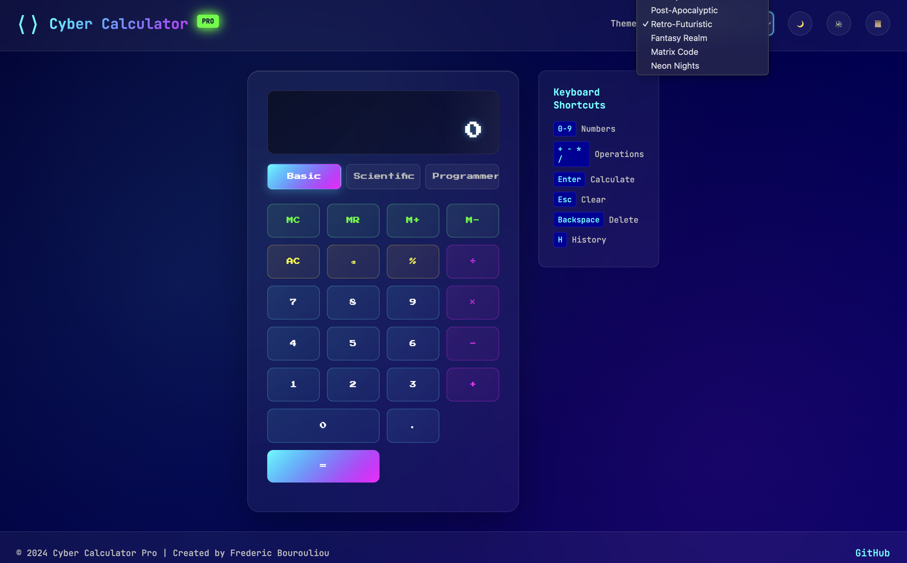

# Cyber Calculator PRO 🎮

[](https://github.com/FredBourouliou)
[](LICENSE)
[]()

A professional multi-mode calculator with immersive themed interfaces, advanced mathematical functions, and stunning visual effects. Built with modern web technologies for an exceptional user experience.



## 🚀 Live Demo

Open `index.html` in your browser or [try it online](#)

## ✨ Features

### 🧮 Three Calculator Modes

#### Basic Mode
- Standard arithmetic operations (+, -, ×, ÷, %)
- Memory functions (MC, MR, M+, M-)
- Full decimal support
- Real-time calculations

#### Scientific Mode
- Trigonometric functions (sin, cos, tan)
- Logarithmic functions (log, ln)
- Power operations (x², x³, eˣ)
- Mathematical constants (π, e)
- Advanced functions (factorial, absolute value, rounding)
- Square root and exponential calculations

#### Programmer Mode
- Number base conversions (HEX, DEC, OCT, BIN)
- Bitwise operations (AND, OR, XOR, NOT)
- Bit shifting (<<, >>)
- Hexadecimal input support (A-F)

### 🎨 Seven Immersive Themes

1. **Cyberpunk 2077**
   - Font: Orbitron (futuristic geometric)
   - Neon blue and pink color scheme
   - Glassmorphism effects with blur
   - Glowing text and buttons
   - Gradient backgrounds with light trails

2. **Steampunk Victorian**
   - Font: Cinzel (elegant serif)
   - Brass and copper color palette
   - Metallic textures and ornate borders
   - Victorian-era typography
   - Mechanical button aesthetics

3. **Post-Apocalyptic**
   - Fonts: Special Elite + VT323 (typewriter + terminal)
   - Terminal-style green text
   - CRT screen flicker effect
   - Distressed interface design
   - Scan lines animation

4. **Retro-Futuristic**
   - Font: Press Start 2P (8-bit pixel)
   - 80's arcade aesthetics
   - Pixelated rendering
   - Classic green-on-black display
   - Retro computer interface

5. **Fantasy Realm**
   - Fonts: UnifrakturMaguntia + Cinzel (gothic medieval)
   - Mystical purple and gold theme
   - Magical glow effects
   - Ethereal gradients
   - Animated magic aura

6. **Matrix Code**
   - Font: VT323 (monospace terminal)
   - Matrix green color scheme
   - Binary code rain animation
   - Terminal scan lines
   - Glowing green text effects

7. **Neon Nights**
   - Fonts: Bungee + Audiowide (bold display)
   - Vibrant neon colors
   - Pulsating light effects
   - Neon glow animations
   - Electric color transitions

### 💡 Advanced Features

- **🌓 Dark/Light Mode**: Independent toggle from themes
- **🔊 Sound Effects**: Synthesized audio feedback for all interactions
- **📜 Calculation History**: Complete history with timestamps
- **💾 Local Storage**: Saves preferences, themes, and history
- **⌨️ Full Keyboard Support**: Complete keyboard navigation
- **📱 Responsive Design**: Works on all devices
- **🎬 Loading Screen**: Professional animated intro
- **✨ Smooth Animations**: Fluid transitions and effects

### ⌨️ Keyboard Shortcuts

| Key | Function |
|-----|----------|
| `0-9` | Input numbers |
| `.` | Decimal point |
| `+ - * /` | Basic operations |
| `%` | Percentage/Modulo |
| `Enter` or `=` | Calculate result |
| `Escape` | Clear all (AC) |
| `Backspace` | Delete last digit |
| `H` | Toggle history panel |

## 🛠️ Technical Stack

### Core Technologies
- **HTML5**: Semantic markup
- **CSS3**: Modern styling with custom properties
- **JavaScript ES6+**: Object-oriented architecture

### Design Features
- CSS Grid for responsive layouts
- CSS Variables for theme management
- Backdrop filters for glass effects
- CSS Animations and transitions
- Web Audio API for sound synthesis

### Fonts Used
- Orbitron (Cyberpunk)
- Cinzel (Steampunk/Fantasy)
- Special Elite (Post-Apocalyptic)
- VT323 (Terminal/Matrix)
- Press Start 2P (Retro Gaming)
- UnifrakturMaguntia (Medieval)
- Bungee & Audiowide (Neon)
- JetBrains Mono (Default)

## 📦 Installation

### Quick Start
```bash
git clone https://github.com/FredBourouliou/cyber-calculator.git
cd cyber-calculator
# Open index.html in your browser
```

### Development
No build process required! This is a vanilla JavaScript application.

```bash
# Optional: Run a local server
python3 -m http.server 8000
# Or with Node.js
npx serve
```

## 📸 Screenshots

<div align="center">
  
  <p><em>Cyber Calculator PRO with Cyberpunk 2077 theme featuring glassmorphism design, neon colors, and advanced calculator modes</em></p>
</div>

## 🎯 Usage

1. **Select a Theme**: Choose from the dropdown menu
2. **Choose Calculator Mode**: Basic, Scientific, or Programmer
3. **Toggle Features**: Dark mode, sounds, history panel
4. **Perform Calculations**: Use mouse or keyboard
5. **View History**: Click the history button to see past calculations
6. **Reuse Results**: Click on history items to use their results

## 🏗️ Architecture

```
cyber-calculator/
├── index.html          # Main HTML structure
├── style.css           # All styles and themes
├── script.js           # Calculator logic (OOP)
├── README.md           # Documentation
└── LICENSE             # MIT License
```

### Key Classes
- `AdvancedCalculator`: Main calculator class with all logic
- Memory management system
- History tracking with timestamps
- Preference storage system
- Audio synthesis engine

## 🔧 Browser Compatibility

| Browser | Version | Status |
|---------|---------|--------|
| Chrome | 90+ | ✅ Full Support |
| Firefox | 88+ | ✅ Full Support |
| Safari | 14+ | ✅ Full Support |
| Edge | 90+ | ✅ Full Support |
| Opera | 76+ | ✅ Full Support |

### Progressive Enhancement
- Fallbacks for older browsers
- Graceful degradation for unsupported features
- Works without JavaScript (basic HTML form)

## 🚀 Performance

- **Optimized animations**: GPU-accelerated transforms
- **Efficient DOM updates**: Minimal reflows
- **Lazy loading**: Features load on demand
- **Local storage caching**: Fast preference loading
- **Debounced inputs**: Smooth user experience

## 🔒 Security

- No external dependencies
- No data collection
- All data stored locally
- XSS protection built-in
- Content Security Policy ready

## 📈 Future Enhancements

- [ ] Graph plotting capabilities
- [ ] Unit conversions
- [ ] Financial calculations
- [ ] Matrix operations
- [ ] Export/Import calculations
- [ ] PWA support
- [ ] Voice commands
- [ ] Custom theme creator
- [ ] Calculation sharing
- [ ] Multi-language support

## 🤝 Contributing

Contributions are welcome! Please feel free to submit a Pull Request.

1. Fork the repository
2. Create your feature branch (`git checkout -b feature/AmazingFeature`)
3. Commit your changes (`git commit -m 'Add some AmazingFeature'`)
4. Push to the branch (`git push origin feature/AmazingFeature`)
5. Open a Pull Request

## 📄 License

This project is licensed under the MIT License - see the [LICENSE](LICENSE) file for details.

## 👨‍💻 Author

**Frederic Bourouliou**

- GitHub: [@FredBourouliou](https://github.com/FredBourouliou)
- Project Link: [https://github.com/FredBourouliou/cyber-calculator](https://github.com/FredBourouliou/cyber-calculator)

## 🙏 Acknowledgments

- Font designers for the amazing typefaces
- The open-source community
- Modern web standards contributors
- All beta testers and contributors

## 📊 Version History

### v2.0 - Professional Edition (Current)
- Complete UI/UX overhaul
- Three calculator modes
- Seven immersive themes
- Sound synthesis system
- History panel with timestamps
- Local storage for preferences
- Advanced mathematical functions
- Programmer mode with base conversions
- Enhanced error handling
- Production-ready code

### v1.0 - Initial Release
- Basic calculator functions
- Five initial themes
- Keyboard support
- Basic animations

---

<div align="center">
  
**🎮 Cyber Calculator PRO - Where Mathematics Meets Art 🎨**

Made with ❤️ and lots of ☕ by Frederic Bourouliou

</div>